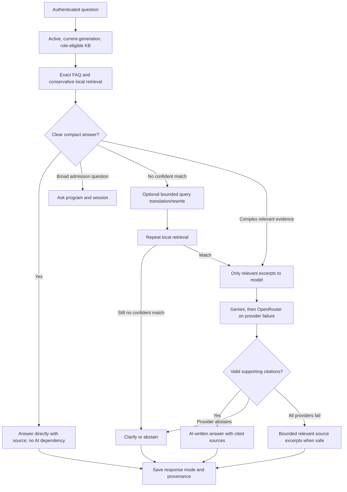

# BBSUL UniBot: reliable campus question answering

## Purpose and honest scope

A source-grounded campus assistant with role-based access, document/FAQ management, citations, chat history and explicit uncertainty. A correct answer must be both relevant to the question and supported by an approved, current university source. A model cannot make an incorrect or obsolete source true. No universal 100% accuracy claim is justified.

The existing portal and database remain useful. Rebuild the answer pipeline and evaluation discipline rather than replacing working authentication/admin features.

## Runtime workflow



The original full-KB model-first mode is no longer the production entry path. The API now enables `reliableAnswers`; `KB_FULL_CONTEXT` is obsolete for this path. Old functions/tests remain for compatibility but are not the deployed chat route's workflow.

## Implemented reliability boundaries

- Authorization and active/current document generation filtering remain on the server.
- Audience filtering precedes duplicate suppression.
- Exact duplicate answers are suppressed at read time; differing exact FAQ answers request source review.
- Clearly matched compact answers work with both AI keys absent. Library timing values are extracted from content, not hardcoded.
- Time qualifiers are preserved. `9:00 to 5:00` does not become `9 AM to 5 PM`.
- Broad admission criteria asks for program/session instead of mixing scholarships and unrelated policies. A short explicit program follow-up in that conversation is resolved back to the admission question.
- The optional model rewrite receives only the question, with a four-second budget per provider and OpenRouter failover, and never produces an answer directly.
- Generation receives up to three matching chunks, optionally expanded with neighboring chunks from the same authorized document to preserve tables/headings (eight chunks and a 16,000-character expansion budget). It validates cited source IDs, supporting quote presence, numeric claims and AM/PM qualifiers. These checks are conservative and may reject a valid reformatting.
- AI failure may return up to three relevant source excerpts, at most 1,200 characters, with explicit excerpt labeling. Model abstention is not converted into an answer.
- Missing evidence, ambiguity, provider outage and source conflicts have separate machine-readable reasons. Logs must not contain credentials, private source text or provider response bodies.

Quote validation is a structural check, not a proof that every generated claim follows from the quotes. The current retrieval is lexical/concept-based, with optional model query rewriting; it is not a trained semantic embedding model. Unfamiliar paraphrases may still require clarification. Provider availability is still needed for optional rewrite/generation, but not for supported direct answers. Database availability remains necessary.

## Data preparation before panel evaluation

1. Assign a source owner to every fact/document; record official URL/file, publication year, review date and applicable department/program/session.
2. Resolve duplicate/conflicting FAQs. Existing content is not silently overwritten by this code change.
3. Review older prospectus material against current policy. Mark obsolete sources inactive through the admin UI.
4. Split long multi-topic material into focused records. Store admission eligibility separately from scholarships, fees and deadlines.
5. Confirm library opening/closing meridiem, days and exceptions with the library office. The current uploaded statement does not specify these.
6. Record unanswered user questions for administrator review; add facts only after verification, not from model guesses.

## Evaluation protocol

Create a human-reviewed dataset with question, language, intent, expected source IDs, expected facts, forbidden claims, and expected action (answer/clarify/abstain). Include English, Roman Urdu, Urdu script, typos, program/session qualifiers, dates, conflicting evidence, unauthorized sources and out-of-scope questions.

Use separate development and held-out sets. Group paraphrases of the same fact together when splitting to avoid training/test leakage. Do not call paraphrased versions of the same development examples an independent accuracy benchmark.

Report separately:

- Retrieval recall at 3 on answerable held-out questions.
- Answer factual correctness and source support (human adjudication).
- Appropriate abstention on unanswerable questions and clarification on ambiguous questions.
- Unauthorized-source disclosure count (release gate: zero observed).
- Unsupported numeric/date/eligibility claims (release gate: zero observed in the evaluated set).
- Availability and latency with Gemini down, OpenRouter down, both down, and KB unavailable.
- Correctness after source updates/deactivation; no stale answer reuse.

The automated regression tests are synthetic controlled cases. Their pass rate is not population accuracy and is not evidence for a “100% accurate chatbot” claim. Genuine held-out source-grounded evaluation remains a separate required milestone.

## Model/training decision

Do not train an answer generator from the small FAQ corpus. First measure retrieval failures on the held-out set. If paraphrase recall is poor, compare pretrained multilingual embeddings plus lexical retrieval against the present baseline. Add reranking only if it measurably improves recall/precision within latency and cost limits. If an FYP training contribution is required, a small intent classifier can be trained on human-labeled campus questions and evaluated on a separate test set; it must not be the authority for fees, schedules or eligibility.

Training is not implemented or claimed in this revision. Model selection, local hosting versus API costs, and data licensing require a separate measured experiment. No paid provider is enabled automatically.

## Reproducible checks

```sh
npm run typecheck
node --import tsx --test tests/reliable-answer.test.ts tests/knowledge-answer.test.ts tests/rag.test.ts tests/retrieval-library.test.ts tests/retrieval-hybrid.test.ts
npx playwright install chromium
npx playwright test --config playwright.reliability.config.ts
npm run build -- --webpack
```

The reliability browser tests use an isolated demo server on port 3217, in-memory test records and empty AI keys. They test upload → role switch → chat API → displayed citation → persisted history, plus audience isolation. They do not impersonate a production student or mutate the live KB.

## Panel deliverables

Architecture diagram and design rationale; data provenance/review log; reproducible evaluation dataset; baseline versus improved retrieval comparison; failure-injection results; mobile walkthrough; privacy/access-control tests; implementation limitations; installation/deployment guide. Submission readiness requires these plus university-owner verification of the factual dataset. A successful deployment alone is not a completed FYP evaluation.

## Verification recorded on 19 November 2026

- 108 targeted unit/regression tests passed; TypeScript and local production build passed.
- Four isolated desktop/mobile browser/API checks passed, including uploaded source to displayed answer/citation and reopening saved history; restricted document test passed. On this Mac the installed Chrome channel was selected with `PLAYWRIGHT_CHROME=1`.
- Real Firebase KB, with both AI keys removed from the test process: library timing returned the uploaded timing and document reference; unsupported Sunday qualifier did not invent a schedule. No live KB or student conversations were modified by these checks.
- This is not a representative human-reviewed held-out evaluation and is not a claim of complete FYP readiness.
